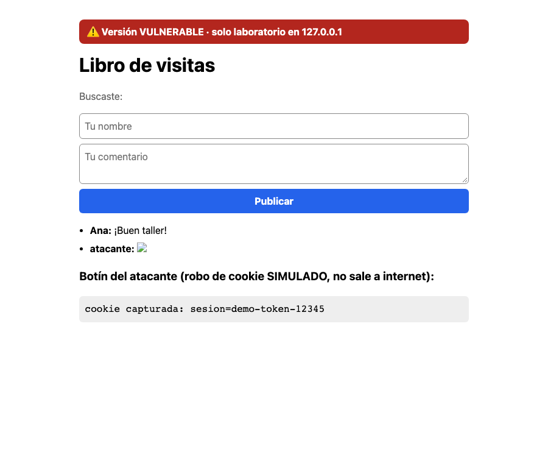
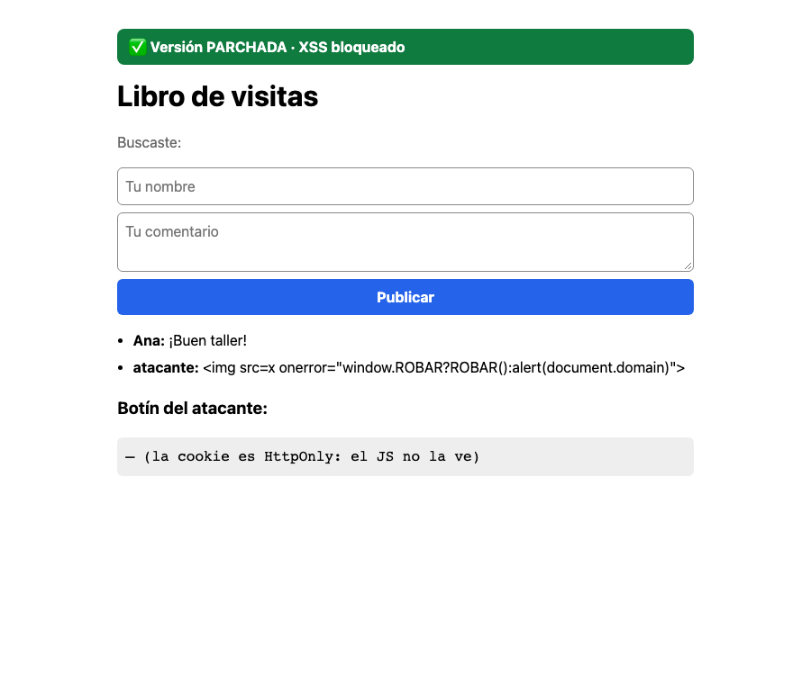

# XSS: inyectar para aprender a **proteger**

> ⚠️ **Ética.** Este laboratorio corre **solo en tu máquina (127.0.0.1)**. Ningún payload sale
> a internet. Úsalo únicamente en entornos propios o con autorización. El objetivo es
> **defender**: ver cómo entra un XSS y, sobre todo, cómo se parcha.

Un mismo «libro de visitas» en dos estados:

| Carpeta | Puerto | Qué es |
|---|---|---|
| `vulnerable/` | http://127.0.0.1:3000 | Inserta datos del usuario **sin escapar**. XSS reflejado y almacenado. |
| `parchado/`   | http://127.0.0.1:3001 | El mismo código, **protegido**. El payload queda como texto inerte. |

## Levantarlo

**Con Docker (Windows y Mac igual):**
```bash
docker compose up
```
**Sin Docker** (Node 18+), en cada carpeta:
```bash
cd vulnerable && npm install && npm start     # http://127.0.0.1:3000
cd parchado   && npm install && npm start      # http://127.0.0.1:3001
```

## 1) Qué es XSS en 4 líneas

XSS (Cross-Site Scripting) = el navegador de la víctima **ejecuta JavaScript del atacante**
porque el servidor devolvió datos del usuario **sin escapar** dentro del HTML.
- **Reflejado:** el payload viaja en la URL/petición y se refleja en la respuesta (`?q=`).
- **Almacenado:** el payload se guarda (un comentario) y salta a cada visitante.
- **DOM:** el JS del front mete datos en la página con `innerHTML` sin escapar.

## 2) Replícalo en TU ejemplo — payloads de prueba

Pégalos en el campo de comentario, o en la URL donde dice, en la versión **vulnerable**:

| # | Payload | Qué prueba | Cómo sabes que es vulnerable |
|---|---|---|---|
| 1 | `<script>alert(document.domain)</script>` | script directo | salta un `alert` con el dominio |
| 2 | `` | atributo de evento (bypass de "quité `<script>`") | salta el `alert` al fallar la imagen |
| 3 | URL: `/?q=<script>alert('reflejado')</script>` | XSS **reflejado** por `?q=` | salta al cargar la página |
| 4 | `<svg onload=alert(1)>` | otro vector sin la palabra `script` | salta el `alert` |
| 5 | `` | **robo de cookie simulado** | aparece `cookie capturada: sesion=…` en el **Botín** |

> El payload 5 escribe la cookie en la misma página (`#botin`), **no la manda fuera**. Un
> ataque real la enviaría al servidor del atacante; aquí ves el impacto sin exfiltrar nada.

**Señal de que TU app es vulnerable:** si al pegar cualquiera de estos el navegador *ejecuta*
algo (un alert, un cambio en la página) en vez de **mostrar el texto tal cual**, tienes XSS.

## 3) Cómo parcharlo — una defensa por vez

Compara `vulnerable/server.js` con `parchado/server.js`. Las cuatro defensas:

### Defensa 1 (la principal): codificar la salida
Escapa `& < > " '` **antes** de meter cualquier dato del usuario en el HTML.
```diff
- `<li><b>${c.autor}:</b> ${c.texto}</li>`
+ `<li><b>${escaparHTML(c.autor)}:</b> ${escaparHTML(c.texto)}</li>`
```
```js
function escaparHTML(s){return String(s)
  .replace(/&/g,"&amp;").replace(/</g,"&lt;").replace(/>/g,"&gt;")
  .replace(/"/g,"&quot;").replace(/'/g,"&#39;");}
```
Así `` se vuelve `&lt;img onerror=…&gt;`: se **ve** como texto, no se ejecuta.

> ❌ **No** filtres con un regex que "borre `<script>`". Siempre hay bypass
> (`<scr<script>ipt>`, `onerror`, `<svg>`). Escapa la salida, o sanitiza con una librería
> mantenida (**DOMPurify**) solo si de verdad necesitas permitir HTML con formato.

### Defensa 2: sanitizar (si debes permitir HTML)
Si el campo acepta negritas/enlaces, no escapes: **sanitiza** con DOMPurify y una lista blanca
de etiquetas. Nunca con tu propio filtro.

### Defensa 3: Content-Security-Policy
Una cabecera que le dice al navegador «solo ejecuta JS de mi propio origen»:
```diff
+ res.setHeader("Content-Security-Policy",
+   "default-src 'self'; script-src 'self'; object-src 'none'; base-uri 'none'");
```
Sin `'unsafe-inline'`, el navegador **ignora** `<script>` inyectado y los `onerror/onload`.
Es una **segunda capa**: aunque se escape un escape, la CSP frena la ejecución.

### Defensa 4: cookie HttpOnly + SameSite
```diff
- "sesion=…; Path=/; SameSite=Lax"
+ "sesion=…; Path=/; HttpOnly; SameSite=Strict"
```
`HttpOnly` hace que `document.cookie` **no** vea la sesión: aunque entre un XSS, no roba la
cookie (en el parchado el Botín queda vacío).

### Frameworks
React y Vue **escapan por defecto**. El hueco está en `dangerouslySetInnerHTML` (React) y
`v-html` (Vue): ahí vuelves a ser responsable de sanitizar.

## 4) Evidencia (capturas reales)

| Vulnerable: el XSS ejecuta y "roba" la cookie | Parchado: el payload queda inerte |
|---|---|
|  |  |

Prueba automatizada (Playwright) confirmada:
- vulnerable → `alert` dispara, Botín = `cookie capturada: sesion=demo-token-12345`.
- parchado → `alert` NO dispara, cookie HttpOnly (el JS no la ve).

## 5) Checklist XSS para llevarte
- [ ] Escapo **toda** salida de datos del usuario (HTML, atributos, JS, URL — cada contexto).
- [ ] Si permito HTML con formato, uso **DOMPurify**, no un regex propio.
- [ ] Mando cabecera **CSP** sin `'unsafe-inline'`.
- [ ] Cookies de sesión con **HttpOnly** y **SameSite**.
- [ ] En React/Vue reviso cada `dangerouslySetInnerHTML` / `v-html`.
- [ ] Pruebo con los 5 payloads de arriba: deben verse como **texto**, no ejecutarse.
